# Data Model (AI)

## 1. Database Diagram

```mermaid
erDiagram
    LearningAPI_assessment {
        integer id PK
        varchar name
        varchar source_url
        integer book_id FK
        varchar type
    }
    LearningAPI_assessmentobjective {
        integer id PK
        integer assessment_id FK
        integer objective_id FK
    }
    LearningAPI_assessmentweight {
        integer id PK
        integer weight_id FK
        integer assessment_id FK
    }
    LearningAPI_book {
        integer id PK
        varchar name
        integer course_id FK
        text description
        integer index
    }
    LearningAPI_capstone {
        integer id PK
        integer student_id FK
        integer course_id FK
        varchar proposal_url
        varchar repo_url
        text description
    }
    LearningAPI_capstonetimeline {
        integer id PK
        integer capstone_id FK
        integer status_id FK
        timestamp_with_time_zone date
    }
    LearningAPI_cohort {
        integer id PK
        varchar name UK
        varchar slack_channel
        date start_date
        date end_date
        date break_start_date
        date break_end_date
        boolean active
    }
    LearningAPI_cohortcourse {
        integer id PK
        integer cohort_id FK
        integer course_id FK
        boolean active
        smallint index
    }
    LearningAPI_cohortevent {
        integer id PK
        integer cohort_id FK
        varchar event_name
        integer event_type_id FK
        timestamp_with_time_zone event_datetime
        text description
        timestamp_with_time_zone created_at
        timestamp_with_time_zone updated_at
    }
    LearningAPI_cohorteventtype {
        integer id PK
        varchar description
        varchar color
    }
    LearningAPI_cohortgithubproject {
        integer id PK
        integer cohort_id FK
        varchar project_name UK
        boolean assessment
        varchar project_url UK
    }
    LearningAPI_cohortinfo {
        integer id PK
        integer cohort_id FK,UK
        varchar student_organization_url
        varchar github_classroom_url
        varchar attendance_sheet_url
        varchar client_course_url
        varchar server_course_url
        varchar zoom_url
    }
    LearningAPI_coreskill {
        integer id PK
        varchar label
    }
    LearningAPI_coreskillrecord {
        integer id PK
        integer student_id FK
        integer skill_id FK
        integer level
        date created_on
    }
    LearningAPI_coreskillrecordentry {
        integer id PK
        integer record_id FK
        text note
        date recorded_on
        integer instructor_id FK
    }
    LearningAPI_course {
        integer id PK
        varchar name
        date date_created
        boolean active
    }
    LearningAPI_foundationsexercise {
        integer id PK
        varchar learner_github_id
        varchar learner_name
        varchar title
        varchar slug
        integer attempts
        boolean complete
        timestamp_with_time_zone completed_on
        timestamp_with_time_zone first_attempt
        timestamp_with_time_zone last_attempt
        text completed_code
        boolean used_solution
    }
    LearningAPI_foundationslearnerprofile {
        integer id PK
        varchar learner_github_id
        varchar learner_name
        varchar cohort_type
        integer cohort_number
    }
    LearningAPI_groupprojectrepository {
        integer id PK
        integer team_id FK
        integer project_id FK
        varchar repository
    }
    LearningAPI_learningobjective {
        integer id PK
        varchar swbat
        integer bloom_level_id FK
    }
    LearningAPI_learningrecord {
        integer id PK
        integer student_id FK
        integer weight_id FK
        boolean achieved
        date created_on
    }
    LearningAPI_learningrecordentry {
        integer id PK
        integer record_id FK
        text note
        date recorded_on
        integer instructor_id FK
    }
    LearningAPI_learningweight {
        integer id PK
        varchar label
        integer weight
        integer tier
    }
    LearningAPI_lightningexercise {
        integer id PK
        varchar name
        text description
    }
    LearningAPI_lightningtag {
        integer id PK
        integer exercise_id FK
        integer tag_id FK
    }
    LearningAPI_nssuser {
        integer id PK
        integer user_id FK,UK
        varchar slack_handle
        varchar github_handle
    }
    LearningAPI_nssusercohort {
        integer id PK
        integer nss_user_id FK
        integer cohort_id FK
        boolean is_github_org_member
    }
    LearningAPI_nssuserteam {
        integer id PK
        integer team_id FK
        integer student_id FK
    }
    LearningAPI_objectivetag {
        integer id PK
        integer objective_id FK
        integer tag_id FK
    }
    LearningAPI_oneononenote {
        integer id PK
        integer student_id FK
        integer coach_id FK
        text notes
        timestamp_with_time_zone session_date
    }
    LearningAPI_opportunity {
        integer id PK
        integer senior_instructor_id FK
        integer cohort_id FK
        varchar portion
        date start_date
        text message
    }
    LearningAPI_opportunityuser {
        integer id PK
        integer student_id FK
        integer opportunity_id FK
        date date_created
    }
    LearningAPI_project {
        integer id PK
        varchar name
        varchar implementation_url
        varchar client_template_url
        varchar api_template_url
        integer book_id FK
        integer index
        boolean active
        boolean is_group_project
    }
    LearningAPI_projectnote {
        integer id PK
        integer user_id FK
        integer project_id FK
        text note
    }
    LearningAPI_projecttag {
        integer id PK
        integer project_id FK
        integer tag_id FK
    }
    LearningAPI_proposalstatus {
        integer id PK
        varchar status
    }
    LearningAPI_studentassessment {
        integer id PK
        integer student_id FK
        integer assessment_id FK
        integer status_id FK
        integer instructor_id FK
        varchar url
        date date_created
    }
    LearningAPI_studentassessmentstatus {
        integer id PK
        varchar status
    }
    LearningAPI_studentmentor {
        integer id PK
        integer student_id FK
        integer mentor_id FK
        integer capstone_id FK
    }
    LearningAPI_studentnote {
        integer id PK
        integer student_id FK
        integer coach_id FK
        integer note_type_id FK
        text note
        timestamp_with_time_zone created_on
    }
    LearningAPI_studentnotetype {
        integer id PK
        varchar label
    }
    LearningAPI_studentpersonality {
        integer id PK
        integer student_id FK,UK
        varchar briggs_myers_type
        integer bfi_extraversion
        integer bfi_agreeableness
        integer bfi_conscientiousness
        integer bfi_neuroticism
        integer bfi_openness
    }
    LearningAPI_studentproject {
        integer id PK
        integer student_id FK
        integer project_id FK
        date date_created
    }
    LearningAPI_studenttag {
        integer id PK
        integer student_id FK
        integer tag_id FK
    }
    LearningAPI_studentteam {
        integer id PK
        varchar group_name
        integer cohort_id FK
        boolean sprint_team
        varchar slack_channel
    }
    LearningAPI_tag {
        integer id PK
        varchar name
    }
    LearningAPI_taxonomylevel {
        integer id PK
        varchar level_name
    }
    auth_user {
        integer id PK
        varchar password
        timestamp_with_time_zone last_login
        boolean is_superuser
        varchar username
        varchar first_name
        varchar last_name
        varchar email
        boolean is_staff
        boolean is_active
        timestamp_with_time_zone date_joined
    }
    LearningAPI_book ||--o{ LearningAPI_assessment : "book"
    LearningAPI_assessment }o--o{ LearningAPI_learningweight : "objectives (via assessmentweight)"
    LearningAPI_assessment ||--o{ LearningAPI_assessmentobjective : "assessment"
    LearningAPI_learningobjective ||--o{ LearningAPI_assessmentobjective : "objective"
    LearningAPI_learningweight ||--o{ LearningAPI_assessmentweight : "weight"
    LearningAPI_assessment ||--o{ LearningAPI_assessmentweight : "assessment"
    LearningAPI_course ||--o{ LearningAPI_book : "course"
    LearningAPI_nssuser ||--o{ LearningAPI_capstone : "student"
    LearningAPI_course ||--o{ LearningAPI_capstone : "course"
    LearningAPI_capstone ||--o{ LearningAPI_capstonetimeline : "capstone"
    LearningAPI_proposalstatus ||--o{ LearningAPI_capstonetimeline : "status"
    LearningAPI_cohort ||--o{ LearningAPI_cohortcourse : "cohort"
    LearningAPI_course ||--o{ LearningAPI_cohortcourse : "course"
    LearningAPI_cohort ||--o{ LearningAPI_cohortevent : "cohort"
    LearningAPI_cohorteventtype ||--o{ LearningAPI_cohortevent : "event_type"
    LearningAPI_cohort ||--o{ LearningAPI_cohortgithubproject : "cohort"
    LearningAPI_cohort ||--|| LearningAPI_cohortinfo : "cohort"
    LearningAPI_nssuser ||--o{ LearningAPI_coreskillrecord : "student"
    LearningAPI_coreskill ||--o{ LearningAPI_coreskillrecord : "skill"
    LearningAPI_coreskillrecord ||--o{ LearningAPI_coreskillrecordentry : "record"
    LearningAPI_nssuser ||--o{ LearningAPI_coreskillrecordentry : "instructor"
    LearningAPI_studentteam ||--o{ LearningAPI_groupprojectrepository : "team"
    LearningAPI_project ||--o{ LearningAPI_groupprojectrepository : "project"
    LearningAPI_taxonomylevel ||--o{ LearningAPI_learningobjective : "bloom_level"
    LearningAPI_nssuser ||--o{ LearningAPI_learningrecord : "student"
    LearningAPI_learningweight ||--o{ LearningAPI_learningrecord : "weight"
    LearningAPI_learningrecord ||--o{ LearningAPI_learningrecordentry : "record"
    LearningAPI_nssuser ||--o{ LearningAPI_learningrecordentry : "instructor"
    LearningAPI_lightningexercise ||--o{ LearningAPI_lightningtag : "exercise"
    LearningAPI_tag ||--o{ LearningAPI_lightningtag : "tag"
    auth_user ||--|| LearningAPI_nssuser : "user"
    LearningAPI_nssuser ||--o{ LearningAPI_nssusercohort : "nss_user"
    LearningAPI_cohort ||--o{ LearningAPI_nssusercohort : "cohort"
    LearningAPI_studentteam ||--o{ LearningAPI_nssuserteam : "team"
    LearningAPI_nssuser ||--o{ LearningAPI_nssuserteam : "student"
    LearningAPI_learningobjective ||--o{ LearningAPI_objectivetag : "objective"
    LearningAPI_tag ||--o{ LearningAPI_objectivetag : "tag"
    LearningAPI_nssuser ||--o{ LearningAPI_oneononenote : "student"
    LearningAPI_nssuser ||--o{ LearningAPI_oneononenote : "coach"
    LearningAPI_nssuser ||--o{ LearningAPI_opportunity : "senior_instructor"
    LearningAPI_cohort ||--o{ LearningAPI_opportunity : "cohort"
    LearningAPI_nssuser ||--o{ LearningAPI_opportunityuser : "student"
    LearningAPI_opportunity ||--o{ LearningAPI_opportunityuser : "opportunity"
    LearningAPI_book ||--o{ LearningAPI_project : "book"
    LearningAPI_nssuser ||--o{ LearningAPI_projectnote : "user"
    LearningAPI_project ||--o{ LearningAPI_projectnote : "project"
    LearningAPI_project ||--o{ LearningAPI_projecttag : "project"
    LearningAPI_tag ||--o{ LearningAPI_projecttag : "tag"
    LearningAPI_nssuser ||--o{ LearningAPI_studentassessment : "student"
    LearningAPI_assessment ||--o{ LearningAPI_studentassessment : "assessment"
    LearningAPI_studentassessmentstatus ||--o{ LearningAPI_studentassessment : "status"
    LearningAPI_nssuser |o--o{ LearningAPI_studentassessment : "instructor"
    LearningAPI_nssuser ||--o{ LearningAPI_studentmentor : "student"
    LearningAPI_nssuser ||--o{ LearningAPI_studentmentor : "mentor"
    LearningAPI_capstone ||--o{ LearningAPI_studentmentor : "capstone"
    LearningAPI_nssuser ||--o{ LearningAPI_studentnote : "student"
    LearningAPI_nssuser ||--o{ LearningAPI_studentnote : "coach"
    LearningAPI_studentnotetype |o--o{ LearningAPI_studentnote : "note_type"
    LearningAPI_nssuser ||--|| LearningAPI_studentpersonality : "student"
    LearningAPI_nssuser ||--o{ LearningAPI_studentproject : "student"
    LearningAPI_project ||--o{ LearningAPI_studentproject : "project"
    LearningAPI_nssuser ||--o{ LearningAPI_studenttag : "student"
    LearningAPI_tag ||--o{ LearningAPI_studenttag : "tag"
    LearningAPI_cohort ||--o{ LearningAPI_studentteam : "cohort"
    LearningAPI_studentteam }o--o{ LearningAPI_nssuser : "students (via nssuserteam)"
```



**Comparison to my pgAdmin ERD:** pgAdmin showed 64 tables because it includes
Django's internal tables (sessions, permissions, content types, etc.), while
Claude scoped this diagram to only the 47 app-level models plus auth_user, per
the prompt. Claude's version is far more readable, since pgAdmin's export only
showed boxes and thin connector lines at a zoomed-out scale, while this one
labels every relationship with its field name and exact cardinality. Claude
also caught two models (OpportunityUser, CohortGithubProject) that weren't
exported from the models package's __init__.py and had to be imported
explicitly, a detail a manual file-by-file read could easily miss.


## 2. Database Info

**Database type:**  PostgreSQL 16 (exact running version: 16.15), declared in
learn-ops-infrastructure/docker-compose.yml:3 (`image: postgres:16`). Matches
my manual finding from reading docker-compose.yml directly.

**ORM:**  Django's built-in ORM (django.db.models.Model), via Django REST
Framework for the API layer. Connection configured in
LearningPlatform/settings.py:195-204 with
ENGINE = 'django.db.backends.postgresql_psycopg2' (an older alias Django
treats the same as django.db.backends.postgresql). Uses psycopg2-binary as
the driver (Pipfile).

## 3. Model to Table Mapping

Claude picked the Book model (I had used StudentNote/StudentNoteType
manually). Both show the same underlying pattern.

| Model Name | Table Name |
|------------|------------|
| Book | LearningAPI_book |

| Property Name | Column Name | Data Type |
|---------------|-------------|-----------|
| id (implicit) | id | integer, identity |
| name | name | character varying(75) |
| course | course_id | integer |
| description | description | text |
| index | index | integer |

**Notes from Claude's response:**
- ForeignKey fields always get `_id` appended as the column name
  (course -> course_id), with an FK constraint and index added automatically.
- Python-side `default=` values (e.g. description default='') are filled in by
  Django before the INSERT; Postgres itself has no column default.
- `@property` methods like `projects` and `has_assessment` are not real
  columns, they run their own queries only when accessed in Python.

**book.save() under the hood:** Claude actually executed the create() method
inside a rolled-back transaction and captured the real SQL:

```sql
INSERT INTO "LearningAPI_book" ("name", "course_id", "description", "index")
VALUES ('Demo Book', 1, 'demo', 1)
RETURNING "LearningAPI_book"."id"
```

It confirmed: Book() only builds an in-memory object; the first real DB call is
Course.objects.get(...) to resolve the course; book.course = course just
copies course.id into course_id; and save() runs INSERT (no pk yet) or
UPDATE (pk already set). RETURNING "id" is how Django gets the new row's id
back immediately after insert. Values are sent as separate SQL parameters,
not string-concatenated, which is what prevents SQL injection.

## 4. Relationship Examples

**One-to-one** (field name: )

**One-to-many** (field name: )

**Many-to-many** (field name: )